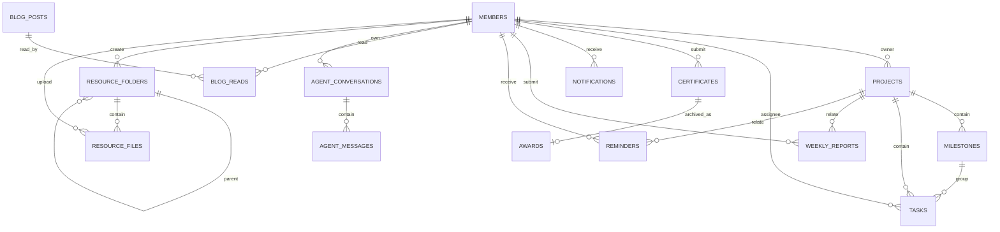

# 数据库设计文档

> 项目：实验室综合官网及智能项目管理平台
> 更新日期：2026-08-09
> 当前共 20 张表，默认 SQLite（`backend/xingyu_cms.db`），可通过 `DATABASE_URL` 切换 PostgreSQL/MySQL。

## 一、数据表总览

| 模块 | 表名 | 用途 |
|------|------|------|
| 系统 | `site_config` | 站点配置（hero/about/contact/sections 等 JSON） |
| 系统 | `admin_users` | 管理员账号 |
| 系统 | `pages` | CMS 页面（about/research/cooperation/recruitment 等） |
| 成员 | `members` | 成员账号与公开资料（含认证字段） |
| 官网 | `projects` | 项目 |
| 官网 | `milestones` | 项目里程碑 |
| 官网 | `tasks` | 任务 |
| 官网 | `awards` | 成果奖项（可关联来源证书） |
| 官网 | `blog_posts` | 博客/公告（含置顶） |
| 官网 | `blog_reads` | 成员博客已读记录 |
| 招新 | `applications` | 招新报名 |
| 互动 | `contact_messages` | 联系我们留言 |
| 资源 | `resource_folders` | 资源中心文件夹（自引用树） |
| 资源 | `resource_files` | 资源文件（软删除） |
| 证书 | `certificates` | 证书记录（OCR 字段 + 审核状态） |
| 通知 | `notifications` | 站内通知 |
| 周报 | `weekly_reports` | 周报（AI 分析 + 审阅） |
| 提醒 | `reminders` | 定时提醒 |
| 智能体 | `agent_conversations` | 智能体会话 |
| 智能体 | `agent_messages` | 智能体消息（含工具调用记录） |

## 二、ER 关系图

## 三、核心表字段说明

### 3.1 系统配置

**site_config**：`id`、`config_key`(VARCHAR 50)、`config_value`(JSON)、`updated_at`

**admin_users**：`id`、`username`(VARCHAR 50，唯一)、`password_hash`(VARCHAR 255)、`created_at`

**pages**：`id`、`slug`(VARCHAR 50，唯一)、`title`(VARCHAR 200)、`content`(JSON)、`updated_at`

### 3.2 成员

**members**

| 字段 | 类型 | 说明 |
|------|------|------|
| id | INTEGER | 主键 |
| name | VARCHAR(100) | 姓名 |
| avatar | VARCHAR(500) | 头像 URL |
| role | VARCHAR(100) | 角色/职务 |
| group | VARCHAR(20) | 分组 product/design/dev/content |
| skills | JSON | 技能标签 |
| github / blog / email | VARCHAR | 联系方式 |
| bio | TEXT | 简介 |
| grade | VARCHAR(20) | 年级 |
| is_alumni | BOOLEAN | 是否校友 |
| status | VARCHAR(20) | active/inactive |
| sort_order | INTEGER | 展示排序 |
| password_hash | VARCHAR(255) | 登录密码哈希 |
| phone | VARCHAR(30) | 手机 |
| student_id | VARCHAR(50) | 学号（登录账号） |
| notification_prefs | JSON | 通知偏好 |
| last_login_at | DATETIME | 最后登录时间 |

### 3.3 官网展示

**projects**：`id`、`slug`(唯一)、`name`、`cover_image`、`category`、`tech_stack`(JSON)、
`description`、`content`(Markdown)、`github_url`、`demo_url`、`stars`、`forks`、
`screenshots`(JSON)、`team`(JSON)、`status`(planning/active/completed/archived)、
`start_date`、`end_date`、`owner_id`(FK members)、`created_at`、`updated_at`

**milestones**：`id`、`project_id`(FK)、`name`、`description`、`due_date`、
`status`(pending/in_progress/completed)、`sort_order`、`created_at`

**tasks**：`id`、`project_id`(FK)、`milestone_id`(FK，可空)、`assignee_id`(FK members，可空)、
`title`、`description`、`status`(todo/in_progress/review/done/blocked)、
`priority`(low/medium/high/urgent)、`due_date`、`sort_order`、`created_at`、`updated_at`

**awards**：`id`、`slug`(唯一)、`name`、`level`(national/provincial/school/other)、`category`、
`winner`、`issuer`、`advisor`、`date`、`description`、`certificate_images`(JSON)、`related_project`、
`certificate_id`(FK certificates，审核归档来源)、`sort_order`、`created_at`、`updated_at`

**blog_posts**：`id`、`slug`(唯一)、`title`、`excerpt`、`content`(Markdown)、
`category`(tech/event/summary/announcement)、`tags`(JSON)、`author_name`、`author_avatar`、
`author_id`(FK members，可空)、`date`、`cover_image`、`is_published`、`pinned`(置顶)、
`created_at`、`updated_at`

**blog_reads**：`id`、`member_id`(FK members)、`blog_id`(FK blog_posts)、`read_at`；
唯一约束 `(member_id, blog_id)`

### 3.4 招新与互动

**applications**：`id`、`name`、`student_id`、`grade_major`、`phone`、`email`、
`group_id`、`group_name`、`github_url`、`portfolio_url`、`experience`、`motivation`、
`session`、`ip_address`、`status`(pending/approved/rejected)、`admin_note`、
`created_at`、`processed_at`

**contact_messages**：`id`、`name`、`email`、`phone`、`subject`、`message`、
`ip_address`、`is_anonymous`、`status`、`admin_note`、`reply`、`replied_at`、
`created_at`、`read_at`

### 3.5 资源中心

**resource_folders**：`id`、`name`、`parent_id`(自引用 FK)、`created_by`(FK members)、
`created_at`、`updated_at`

**resource_files**：`id`、`folder_id`(FK)、`name`、`file_path`、`file_type`、`file_size`、
`uploaded_by`(FK members)、`is_deleted`(软删除)、`created_at`、`updated_at`

### 3.6 证书

**certificates**

| 字段 | 类型 | 说明 |
|------|------|------|
| id | INTEGER | 主键 |
| member_id | INTEGER FK | 提交者 |
| name | VARCHAR(300) | 证书/奖项名称 |
| level | VARCHAR(20) | 获奖等级 |
| category | VARCHAR(50) | 类别 |
| winner | VARCHAR(200) | 获奖者 |
| issuer | VARCHAR(200) | 颁奖单位 |
| advisor | VARCHAR(200) | 指导教师（OCR 识别，可为空） |
| date | VARCHAR(20) | 获奖时间 |
| description | TEXT | 描述 |
| images | JSON | 证书图片 URL |
| ocr_text | TEXT | OCR 识别原文 |
| ocr_fields | JSON | OCR 结构化字段（自动回填） |
| related_project | VARCHAR(100) | 关联项目 slug |
| status | VARCHAR(20) | pending/verified/rejected |
| review_note | TEXT | 审核批注 |
| reviewed_by | INTEGER | 审核管理员 |
| reviewed_at | DATETIME | 审核时间 |

### 3.7 通知

**notifications**：`id`、`member_id`(FK)、`type`(task_assigned/status_change/milestone/announcement)、
`title`、`body`、`link`、`is_read`、`created_at`

### 3.8 周报与提醒

**weekly_reports**：`id`、`member_id`(FK)、`project_id`(FK，可空)、`week_start`、`week_end`、
`content`(JSON：done/plan/issues/summary)、`completion_rate`、`ai_analysis`(JSON：
score/completion/risks/suggestions/report)、`status`(draft/submitted/reviewed)、
`review_note`、`reviewed_by`、`submitted_at`、`reviewed_at`、`created_at`、`updated_at`

**reminders**：`id`、`member_id`(FK)、`project_id`(FK，可空)、
`type`(task_due/report_submit/review/custom)、`title`、`message`、`link`、
`scheduled_at`、`sent_at`、`status`(pending/sent/done/cancelled)、`created_by`、`created_at`

### 3.9 智能体

**agent_conversations**：`id`、`member_id`(FK，会话隔离)、`title`、`created_at`、`updated_at`

**agent_messages**：`id`、`conversation_id`(FK，级联删除)、`role`(user/assistant)、
`content`(TEXT)、`tool_calls`(JSON 工具调用记录)、`created_at`

## 四、迁移策略

- 新表由 `db.create_all()` 自动创建（启动时执行）。
- 新列通过 `app.py::_migrate_columns()` 增量添加（SQLite 兼容，幂等）。
- 生产环境建议切换 PostgreSQL 后使用正式迁移工具（Alembic）管理后续变更。
