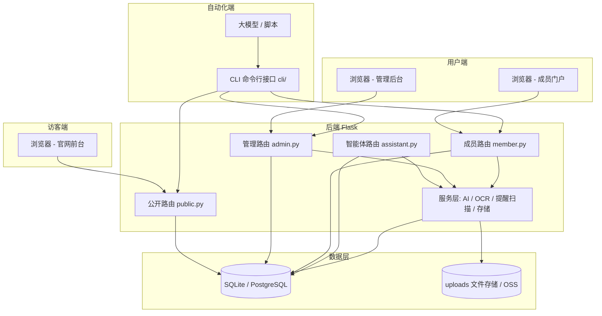
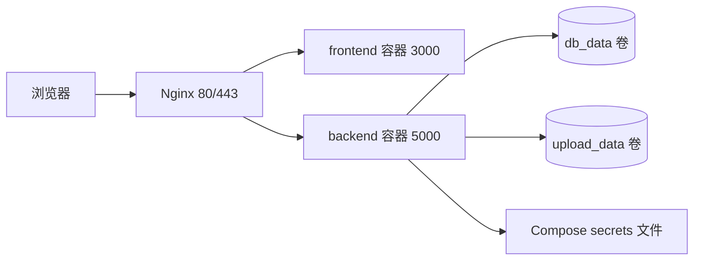

# 系统架构文档

> 项目：实验室综合官网及智能项目管理平台（星雨作坊）
> 更新日期：2026-08-09

## 一、总体架构

系统采用 B/S 架构 + 大模型专用 CLI 双接口，后端为 Flask REST API，
前端为 React SPA，数据统一存储于同一数据库，双接口实时同步。



## 二、技术栈

| 层级 | 技术 | 说明 |
|------|------|------|
| 后端 | Python 3.12 / Flask 3 | REST API 服务 |
| ORM | Flask-SQLAlchemy | 数据库访问，SQLite 默认，支持 PostgreSQL/MySQL |
| 认证 | Flask-JWT-Extended | 管理员/成员双体系 JWT |
| 前端 | React 19 + TypeScript + Vite 8 + Tailwind CSS 4 | 官网前台 + 管理后台 + 成员门户三合一 SPA |
| 前端动画 | Framer Motion / GSAP | 交互效果 |
| CLI | Python Click + 标准库 urllib | 命令行双接口，无额外依赖 |
| AI/OCR | OpenAI 兼容 Chat Completions（DeepSeek/Qwen/GLM/Kimi 等） | 智能体、周报分析、证书识别 |
| 存储 | 本地 uploads/ 或阿里云 OSS | 文件上传 |
| 部署 | Docker Compose + Nginx | 开发/生产/TLS 三套配置 |
| 测试 | pytest / oxlint / tsc | 后端 140 个用例 |

## 三、模块划分

### 3.1 官网前台（公开）

首页、关于、成员、项目、奖项、博客（含公告置顶与已读）、开源、研究方向、
合作交流、时间线、入门、雨记、加入申请、联系我们（留言表单）、统一登录注册。

对应后端：`backend/routes/public.py`；前端：`frontendnew/src/components/pages|sections`。

### 3.2 管理后台

仪表盘、成员管理、证书审核、项目管理（概览/看板/里程碑/周报/提醒/统计）、
奖项管理、博客管理（含置顶）、页面管理、站点配置（含联系我们）、入社申请、
留言管理、数据导入导出。

对应后端：`backend/routes/admin.py`；前端：`frontendnew/src/components/admin`。

### 3.3 成员门户（个人中心）

工作台、我的项目、任务看板、我的任务、资源中心、证书管理（AI 识别）、
通讯录、通知中心、个人资料、AI 助手（对话/需求拆解/周报）。

对应后端：`backend/routes/member.py`；前端：`frontendnew/src/components/member`。

### 3.4 智能识别引擎

`backend/services/ocr_service.py`：基于视觉大模型的结构化识别，
输出获奖名称/等级/类别/获奖人/颁奖单位/获奖时间/描述 + 原文转录，
识别结果自动回填表单，经管理员审核后自动归档成果库。

### 3.5 智能项目管理智能体

`backend/routes/assistant.py` + `backend/services/assistant_tools.py`：
Function Calling 工具循环（27 个工具）、SSE 流式输出、会话持久化与隔离、
自然语言需求解析 → 方案确认 → 落地创建项目/里程碑/任务、
周报 AI 分析、提醒扫描服务（`reminder_service.py` 后台线程）。

### 3.6 CLI 双接口

`cli/` 包：auth/project/task/report/award/member/config/reminder/notify 命令组，
全部复用 REST API，与 Web 端共享数据库，支持表格与 JSON 输出。

## 四、认证与权限

- 管理员：`admin_users` 表，JWT identity 为纯数字 ID。
- 成员：`members` 表，JWT identity 为 `member:<id>`，登录方式为学号/邮箱 + 密码。
- 统一登录：`POST /api/auth/login` 自动识别管理员或成员。
- 权限矩阵：公开接口免登录；成员接口需成员 token；管理接口需管理员 token；
  CLI 按当前登录角色自动选择可用命令。

## 五、数据流要点

1. 前台数据：`useSiteData` 拉取 `/api/config|projects|members|awards|blogs`，
   失败时回退本地默认数据，保证离线可渲染。
2. CMS 内容：`pages` 表存储页面 JSON，`site_config` 存储站点配置，
   后台修改即时生效。
3. 双接口同步：Web 与 CLI 都写同一 REST API + 同一数据库，无独立副本。
4. 异步任务：提醒扫描为 Flask 应用内守护线程，按 `REMINDER_SCAN_INTERVAL` 轮询，
   到期生成站内通知。

## 六、部署拓扑



- 开发：`docker-compose.yml`（backend:5000 + frontend:3000，热重载）。
- 生产：`docker-compose.prod.yml`（Nginx 80 + Flask gunicorn，密钥走 secrets 文件）。
- TLS：`docker-compose.prod.tls.yml` + `deploy/nginx/tls.conf`。
- 备份：数据库与上传目录卷归档，详见 `docs/deployment.md`。

## 七、目录结构

```text
backend/                 Flask 后端
  routes/                public / admin / member / assistant 蓝图
  services/              ai_service / ocr_service / assistant_tools / reminder_service / storage_service
  models.py              20 张数据表
  defaults.py            默认站点配置与 CMS 页面
  app.py                 应用工厂 + 自动迁移 + 种子数据
  tests/                 140 个 pytest 用例
cli/                     CLI 命令行客户端（Click）
frontendnew/             React SPA（官网 + 管理后台 + 成员门户）
docs/                    架构/数据库/接口/操作手册/测试报告等交付文档
deploy/                  Nginx 配置与证书目录
docker-compose*.yml      Docker Compose 开发/生产/TLS 编排
```

